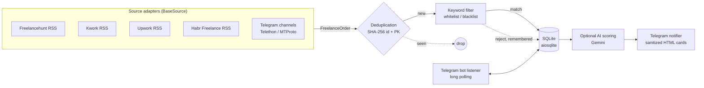

# freelance-aggregator-pipeline

> Fault-tolerant, asyncio-based ingestion pipeline that aggregates freelance orders from five heterogeneous sources, deduplicates them atomically, filters and optionally AI-scores them, and delivers actionable alerts to Telegram in near real time.


---

## Architecture Overview

The service is a **staged, source-agnostic ingestion pipeline**. Every external system is hidden behind a single abstraction, so adding a new data source never touches the pipeline core.



**Design principles actually implemented in the code:**

- **Adapter pattern for sources.** `BaseSource` (abstract, async `fetch_orders()` + `close()`) is the only contract the pipeline depends on. Each source normalizes its raw payload into one canonical Pydantic model, `FreelanceOrder`.
- **Failure isolation per source.** Each source is polled inside its own `try/except`; a broken feed, a `403` from Upwork or a `410 Gone` from Habr is logged and skipped, and the rest of the cycle continues.
- **Idempotent, deterministic identity.** Order IDs are derived as `sha256(source:unique_key)`, so the same listing always maps to the same ID across restarts and runs.
- **Graceful lifecycle.** `SIGINT`/`SIGTERM` set a shared `asyncio.Event`; the polling loop and the bot listener stop cleanly and sources release their resources via `close()`.
- **Graceful degradation.** AI scoring and Telegram channel monitoring are optional. When credentials are missing, those stages return a neutral result instead of failing the cycle.

---

## Key Features

### 1. Atomic deduplication at the data layer
Deduplication is enforced by the database, not just by application logic. `seen_orders.id` is a `PRIMARY KEY`; `save_order_if_new()` performs the insert and treats `aiosqlite.IntegrityError` as the "already exists" signal, which makes the check-and-write step safe even if the same order arrives twice. Secondary indexes on `source` and `created_at` back the statistics and recency queries. Rejected orders are persisted too, so they are never re-evaluated.

### 2. Validated, sanitized, typed data flow
- Configuration is a typed `pydantic-settings` model loaded from the environment / `.env` (with a custom validator for `TELEGRAM_API_ID`).
- Every order is validated through a Pydantic v2 model before it enters the pipeline.
- All user-controlled text (title, description, budget, AI output) is passed through `html.escape` before it is rendered into Telegram HTML cards.
- Keyword matching uses escaped, word-boundary regexes (`\b...\b`), so `bot` does not match `robot`.
- The interactive bot **ignores any chat that is not the configured owner chat** (authorization guard in `handle_update`).

### 3. Fully asynchronous I/O
`httpx.AsyncClient` with explicit per-source timeouts for feeds and the Telegram Bot API, `aiosqlite` for storage, `Telethon` for MTProto channel reading, and a long-polling `getUpdates` loop with handling for session conflicts (`409`). Feed parsing is done with `feedparser` and `BeautifulSoup4`.

### 4. Operable out of the box
- Interactive Telegram control panel: `/stats`, `/last`, `/filters`, and an on-demand **"check now"** scan that reuses the same pipeline function as the scheduler.
- Optional **Gemini scoring** (`response_mime_type: application/json`, low temperature) that returns a 1–10 score, a verdict and a bid tip; any failure falls back silently to an unscored alert.
- A `systemd` unit (`freelance-parser.service`) with `Restart=always` for unattended operation.
- Secrets, sessions and databases are excluded via `.gitignore`; `.env.example` documents every setting.

---

## Tech Stack & Rationale

| Technology | Why it was chosen |
| :-- | :-- |
| **Python 3.12 + `asyncio`** | The workload is I/O-bound (HTTP feeds, MTProto, Bot API); cooperative concurrency keeps one process lightweight and the control flow explicit. |
| **Pydantic v2 / pydantic-settings** | One validated domain model for heterogeneous sources and typed, environment-driven configuration instead of ad-hoc dicts. |
| **httpx** | Async-native HTTP client with first-class timeouts, redirects and exception hierarchy. |
| **aiosqlite** | Non-blocking persistence with zero operational overhead; the `PRIMARY KEY` constraint gives correct dedup semantics. SQLite is a deliberate fit for a single-node service. |
| **feedparser + BeautifulSoup4** | Robust RSS/Atom parsing plus HTML cleanup for budget and description extraction. |
| **Telethon** | MTProto userbot access to public Telegram channels that expose no RSS. |
| **Google Gemini (REST)** | Optional relevance scoring with structured JSON output and no SDK dependency. |
| **systemd** | Supervised restarts and boot-time start on a Linux host. |

---

## Data Sources

| Source | Transport | Notes |
| :-- | :-- | :-- |
| Freelancehunt | RSS | Budget parsing from titles |
| Kwork | RSS | Budget and description extraction |
| Upwork | RSS | Skill / rate extraction; handles `403` gracefully |
| Habr Freelance | RSS | Handles `410 Gone` explicitly |
| Telegram channels | Telethon (MTProto) | Last 15 messages per channel, configurable list |

---

## Project Structure

```text
├── main.py                  # Orchestrator: polling loop, signal handling, lifecycle
├── config/settings.py       # Typed settings, keyword lists, polling interval
├── models/order.py          # FreelanceOrder domain model + deterministic ID
├── sources/                 # BaseSource + one adapter per data source
├── pipeline/
│   ├── filter.py            # Whitelist/blacklist matching
│   └── scorer.py            # Optional Gemini scoring
├── storage/db.py            # Async SQLite repository (dedup, stats, history)
├── notify/
│   ├── telegram.py          # Sanitized HTML alert cards
│   └── bot_listener.py      # Owner-only interactive control bot
├── tests/                   # Smoke and source integration scripts
└── freelance-parser.service # systemd unit
```

---

## Getting Started

```bash
git clone https://github.com/NURJAKS/freelance-aggregator-pipeline.git
cd freelance-aggregator-pipeline
python3 -m venv .venv && source .venv/bin/activate
pip install -r requirements.txt
cp .env.example .env      # fill in credentials
python main.py
```

| Variable | Required | Purpose |
| :-- | :-- | :-- |
| `TELEGRAM_BOT_TOKEN`, `TELEGRAM_CHAT_ID` | Yes | Alert delivery and bot control |
| `TELEGRAM_API_ID`, `TELEGRAM_API_HASH` | Optional | Enables Telegram channel monitoring |
| `GEMINI_API_KEY`, `AI_SCORING_ENABLED` | Optional | Enables AI scoring |
| `POLL_INTERVAL_SECONDS` | Optional | Scan interval (default 180) |

Run as a service: adjust paths in `freelance-parser.service`, copy it to `~/.config/systemd/user/`, then `systemctl --user enable --now freelance-parser`.

Tests: `python tests/test_smoke.py` and `python tests/test_sources.py`.

---

## Roadmap

- Convert the smoke/integration scripts to `pytest` with mocked HTTP.
- Run source polling concurrently with `asyncio.gather`.
- Schedule the existing `cleanup_old()` retention routine.
- Add a `Dockerfile` for containerized deployment.
